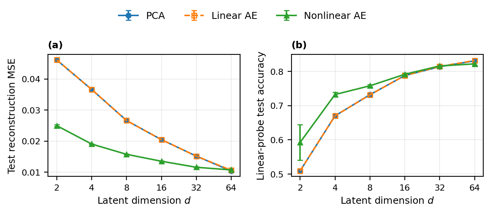

# PCA vs Autoencoders for Dimensionality Reduction

Course project for *Contemporary Statistics with Applications* (University of Groningen).
Author: Aalam Sultanji

This repository compares Principal Component Analysis (PCA) with linear and nonlinear autoencoders (AEs) as dimensionality-reduction methods on Fashion-MNIST. The question is not simply *which method is better*, but **how much nonlinearity buys over PCA, at which latent dimension, and at what cost**.

## Idea

Two classical results frame the experiment:

- **Eckart–Young (1936):** the rank-$d$ truncated SVD, i.e. PCA, is the optimal rank-$d$ linear reconstruction in squared error. No linear method can beat PCA on reconstruction MSE.
- **Baldi & Hornik (1989):** a linear autoencoder trained with MSE has no spurious local minima, and its optimum spans the PCA subspace.

A **linear AE** should therefore reproduce PCA, which validates the training pipeline. Any advantage of a **nonlinear AE** has to come from nonlinearity itself. The experiment measures where, and by how much, that advantage appears.

## Repository structure

```
PCA-vs-AE/
├── data.py          # Fashion-MNIST loading, [0,1] scaling, flattening, train/val split (seed 42)
├── PCA.py           # PCA from first principles (covariance eigendecomposition)
├── autoencoder.py   # Dense autoencoder; activation=True -> ReLU (nonlinear), False -> linear
├── train.py         # Training loop: Adam, cosine LR schedule, best-val checkpoint, early stopping
├── metrics.py       # Reconstruction MSE, variance-weighted R², linear-probe accuracy
├── main.py          # Full experiment: latent-dim sweep x seeds -> results/results.csv
├── plot.py          # Main figure -> figures/main_figure.{pdf,png}
├── results/
│   ├── results.csv  # One row per (model, d, seed)
└── figures/
    └── main_figure.png
```

## Setup

- **Data:** Fashion-MNIST (Xiao et al., 2017), 28×28 grayscale images flattened to 784-dimensional vectors and scaled to [0, 1]. The 60k training images are split 54k / 6k into train / validation (seed 42); the official 10k test set is used only for evaluation.
- **PCA:** implemented from scratch by eigendecomposition of the training-set covariance; fit on the training split only.
- **Autoencoders:** a dense encoder 784 → 128 → 64 → d with a mirrored decoder, a linear bottleneck and a linear output. The **linear AE** uses identity activations; the **nonlinear AE** uses ReLU on the hidden layers. Both share the same architecture and training protocol.
- **Training:** MSE loss, Adam (lr 10⁻³) with cosine annealing to 10⁻⁵ over 100 epochs, batch size 256. The best validation checkpoint is restored, with early stopping (patience 20) as a safeguard.
- **Sweep:** latent dimension d ∈ {2, 4, 8, 16, 32, 64}, with 5 seeds per AE configuration. PCA is deterministic.
- **Metrics (test set):**
  - per-pixel reconstruction MSE,
  - variance-weighted R² (equal to the explained-variance ratio for PCA),
  - downstream accuracy of a logistic-regression probe on the standardized latent codes,
  - fit time.

## Usage

```bash
git clone https://github.com/AalamSultanji/PCA-vs-AE.git
cd PCA-vs-AE
pip install numpy pandas scipy scikit-learn matplotlib torch torchvision

python main.py     # full experiment (Fashion-MNIST downloads to data/ on first run)
python plot.py     # regenerate the main figure
```

`main.py` has a `SMOKE` flag. `SMOKE = True` runs a one-minute end-to-end test (d = 4, one seed, 2 epochs, 5k samples). Set it to `False` for the full experiment.

## Results



*(a) Test reconstruction MSE and (b) linear-probe accuracy against latent dimension (mean ± std over 5 seeds).*

| d | PCA MSE | Linear AE MSE | Nonlinear AE MSE | Nonlinear vs PCA | PCA dims to match nonlinear AE | Accuracy: PCA → nonlinear AE |
|---|---|---|---|---|---|---|
| 2 | 0.04610 | 0.04611 | 0.02496 | −45.9% | 10 (5.0×) | 0.509 → 0.592 |
| 4 | 0.03660 | 0.03663 | 0.01904 | −48.0% | 20 (5.0×) | 0.670 → 0.733 |
| 8 | 0.02661 | 0.02661 | 0.01573 | −40.9% | 30 (3.8×) | 0.732 → 0.758 |
| 16 | 0.02045 | 0.02045 | 0.01350 | −34.0% | 41 (2.6×) | 0.788 → 0.792 |
| 32 | 0.01514 | 0.01515 | 0.01156 | −23.7% | 54 (1.7×) | 0.814 → 0.816 |
| 64 | 0.01037 | 0.01059 | 0.01070 | +3.2% | 61 (1.0×) | 0.831 → 0.822 |

"PCA dims to match" is the smallest number of principal components whose test R² equals the nonlinear AE's mean R².

**Key findings**

1. **The linear AE matches PCA.** It is within 0.06% of PCA's MSE for d ≤ 32 and within the 2% optimization slack at d = 64, as theory predicts.
2. **Nonlinearity pays off most at small d.** The nonlinear AE matches PCA with 5× fewer dimensions at d ≤ 4. The advantage shrinks steadily with d and reaches a tie at d = 64 (+3.2% ± 2.6%, within optimization slack).
3. **Reconstruction and class information decouple.** The nonlinear AE's accuracy advantage disappears by d = 16, while its MSE advantage is still 34%. Beyond that point, the extra variance it captures is not linearly class-relevant.
4. **Cost.** PCA fits in about 0.5 s on CPU, and one eigendecomposition gives every d. Each AE takes about 90–125 s on GPU, roughly 200× more, before any hyperparameter tuning.

## Limitations and future work

- **Fixed hidden widths.** The hidden layers stay at (128, 64), so the ratio of the narrowest nonlinear layer to d shrinks from 32 to 1 across the sweep. The tie at d = 64 may partly reflect limited capacity. A wider-network ablation at d ∈ {32, 64} would separate this from the intrinsic effect.
- **Single dataset, dense AE only.** A convolutional AE would add a spatial inductive bias on top of nonlinearity. A synthetic dataset with a tunable nonlinearity would map the crossover more cleanly.
- **Linear probe only.** Accuracy measures linear separability of the codes, not all class information.

## References

- Baldi, P., & Hornik, K. (1989). Neural networks and principal component analysis: Learning from examples without local minima. *Neural Networks*, 2(1), 53–58.
- Bourlard, H., & Kamp, Y. (1988). Auto-association by multilayer perceptrons and singular value decomposition. *Biological Cybernetics*, 59(4–5), 291–294.
- Eckart, C., & Young, G. (1936). The approximation of one matrix by another of lower rank. *Psychometrika*, 1(3), 211–218.
- Hastie, T., Tibshirani, R., & Friedman, J. (2009). *The Elements of Statistical Learning* (2nd ed.). Springer.
- Loshchilov, I., & Hutter, F. (2017). SGDR: Stochastic gradient descent with warm restarts. *ICLR*.
- Xiao, H., Rasul, K., & Vollgraf, R. (2017). Fashion-MNIST: A novel image dataset for benchmarking machine learning algorithms. *arXiv:1708.07747*.
